  <a href="https://icyzh.dev"><code>portfolio</code></a>&nbsp;&nbsp;·&nbsp;&nbsp;<a href="https://leetcode.com/u/icybear02/"><code>leetcode</code></a>&nbsp;&nbsp;·&nbsp;&nbsp;<a href="mailto:mohitmadan128@gmail.com"><code>mohitmadan128@gmail.com</code></a>

<picture>
  <source media="(prefers-color-scheme: dark)" srcset="https://raw.githubusercontent.com/icyzh/icyzh/output/snake-dark.svg" />
  
</picture>

  

 
